# Module ESP32 Ethernet UART TTL công nghiệp

Module nối một thiết bị có cổng UART TTL 3,3 V vào mạng. Tín hiệu UART đi qua tầng cách ly 5 kV, rồi ESP32-S3 đưa dữ liệu lên mạng bằng Ethernet hoặc Wi-Fi. Mạch chạy nguồn 9–36 V.

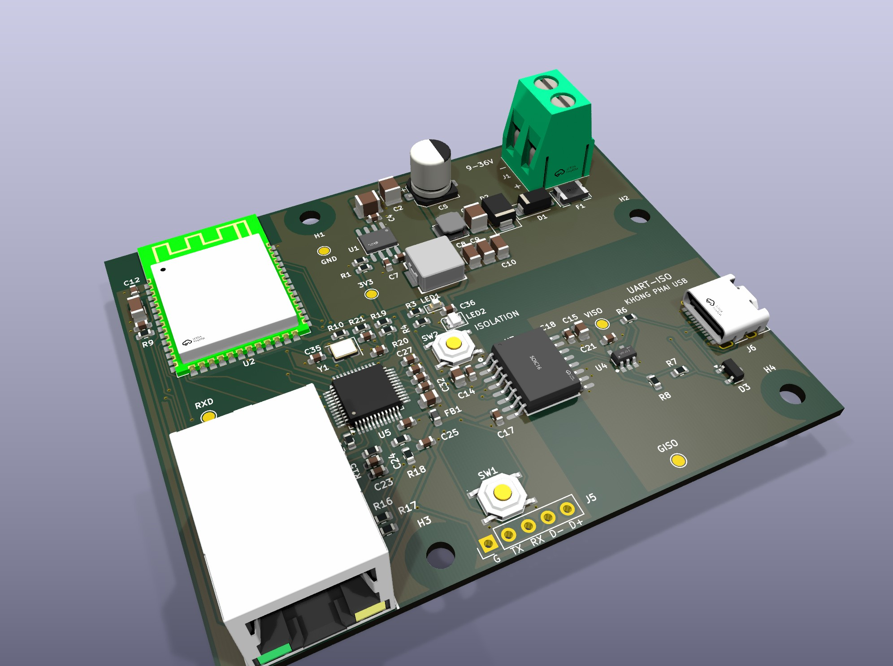

**Tình trạng: Rev B, chưa sản xuất.** Mạch đã đi dây xong, qua kiểm tra luật thiết kế của KiCad và sắp đặt 5 mạch thử. Mọi thứ trong kho này chưa được kiểm chứng trên mạch thật.

| | |
|---|---|
| Kích thước | 80 × 66 mm, 2 lớp, dày 1,6 mm, đồng 1 oz |
| Nguồn vào | 9–36 V qua cọc vít, hạ áp bằng LMR36520 xuống 3,3 V |
| Vi điều khiển | ESP32-S3-WROOM-1-N8, anten mạch in |
| Ethernet | W5500 nối qua SPI, cổng RJ45 HR911105A có sẵn biến áp |
| UART | TTL 3,3 V, cách ly 5 kV bằng CA-IS3642HVW, khe cách ly trên mạch 7,6 mm |
| Đèn báo | LED nguồn và LED trạng thái RGB WS2812B-2020 trên IO38 |
| Linh kiện | 74 linh kiện, 43 loại, lắp một mặt |
| Phần mềm | KiCad 9 |

## Cần góp ý ở đâu

Rất mong nhận góp ý qua mục Issues, nhất là ở bốn chỗ:

1. Mạch hạ áp và lọc đầu vào: vị trí tụ, vòng dòng, tản nhiệt.
2. Đi dây Ethernet trên mạch 2 lớp: hai cặp TX, RX, thạch anh, lớp mass bên dưới.
3. Vùng cách ly: khoảng cách và linh kiện hai phía.
4. Vùng anten của ESP32: vùng cấm đồng, lỗ vít gần anten.

## Trong kho có gì

| Thư mục | Nội dung |
|---|---|
| [`kicad/`](kicad) | Dự án KiCad 9: mạch in, sơ đồ nguyên lý 5 trang, thư viện ký hiệu và footprint |
| [`fab/`](fab) | File đặt sản xuất: Gerber và file khoan, danh sách linh kiện, vị trí linh kiện |
| [`docs/`](docs) | Sơ đồ nguyên lý bản PDF và ảnh |
| [`tools/`](tools) | Bảng nối dây, công cụ sinh sơ đồ và đối chiếu với mạch in, công cụ kiểm tra file lắp ráp |

Mở dự án bằng file `kicad/esp32-eth-uart-module.kicad_pro`. Kho không kèm mô hình 3D của linh kiện nên trình xem 3D của KiCad chỉ hiện bo mạch trống.

## Sơ đồ khối

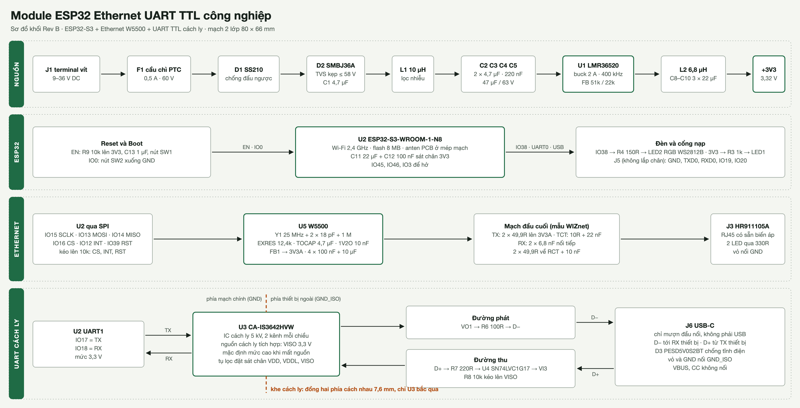

## Sơ đồ nguyên lý

Bản PDF đủ 5 trang: [`docs/so-do-nguyen-ly.pdf`](docs/so-do-nguyen-ly.pdf). Bấm vào từng ảnh để xem cỡ lớn.

| Trang | Ảnh |
|---|---|
| Nguồn 9–36 V sang 3,3 V | [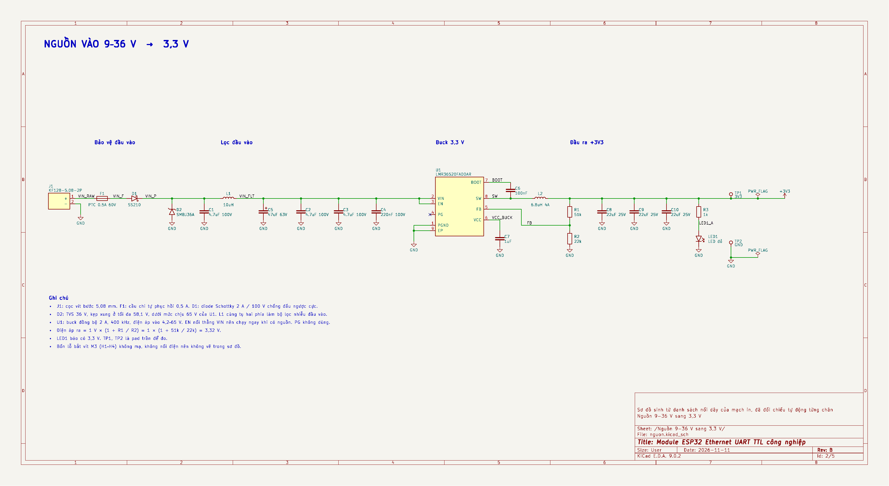](docs/img/so-do-2-nguon.png) |
| Vi điều khiển ESP32-S3 | [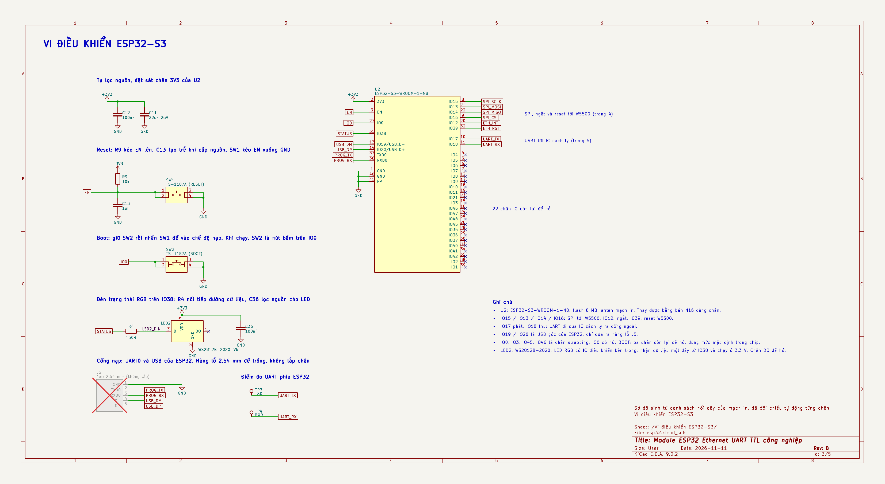](docs/img/so-do-3-esp32.png) |
| Ethernet W5500 | [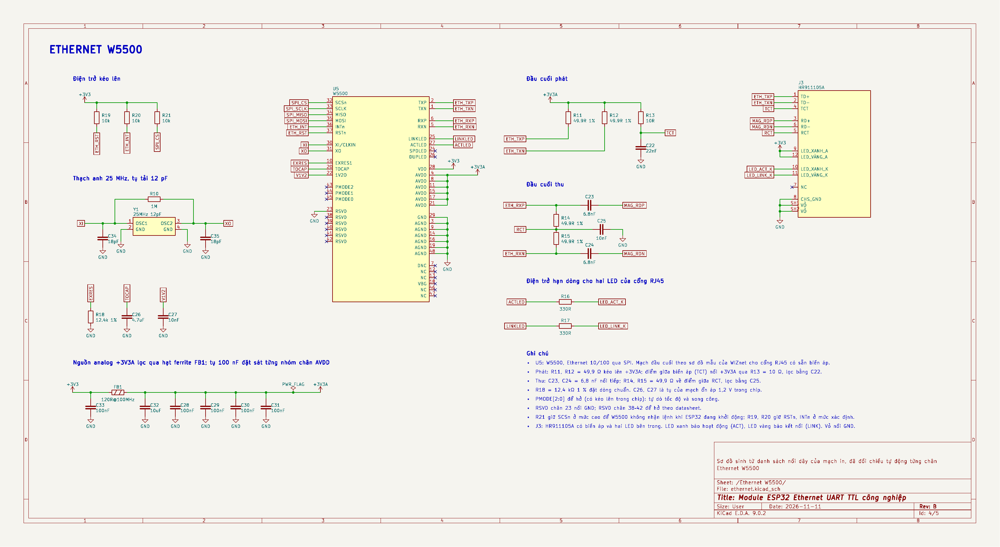](docs/img/so-do-4-ethernet.png) |
| UART TTL cách ly | [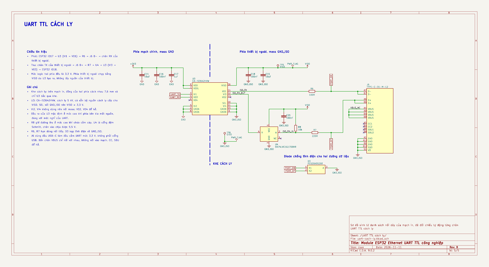](docs/img/so-do-5-uart.png) |

Mạch này được làm theo thứ tự ngược với thông thường: linh kiện được đặt bằng script từ bảng nối dây [`tools/netlist.py`](tools/netlist.py), đi dây tự động rồi chỉnh tiếp. Sơ đồ nguyên lý được sinh sau, cũng từ bảng đó, để người xem dễ đọc. Vì vậy **file mạch in là bản gốc**. Đừng chạy "Update PCB from Schematic": sáu pad đo mang tên khác nhau ở hai bên (TP1–TP6 trong sơ đồ, 3V3/GND/TXD/RXD/VISO/GISO trên mạch) và footprint trên mạch chưa gắn với ký hiệu trong sơ đồ.

Sơ đồ được đối chiếu tự động với mạch in bằng [`tools/schematic/check_sch.py`](tools/schematic/check_sch.py): 81 linh kiện, 53 đường mạch và 256 chân đều khớp, tên đường mạch cũng trùng. Kiểm tra luật điện (ERC) của KiCad không báo lỗi.

## Mạch in

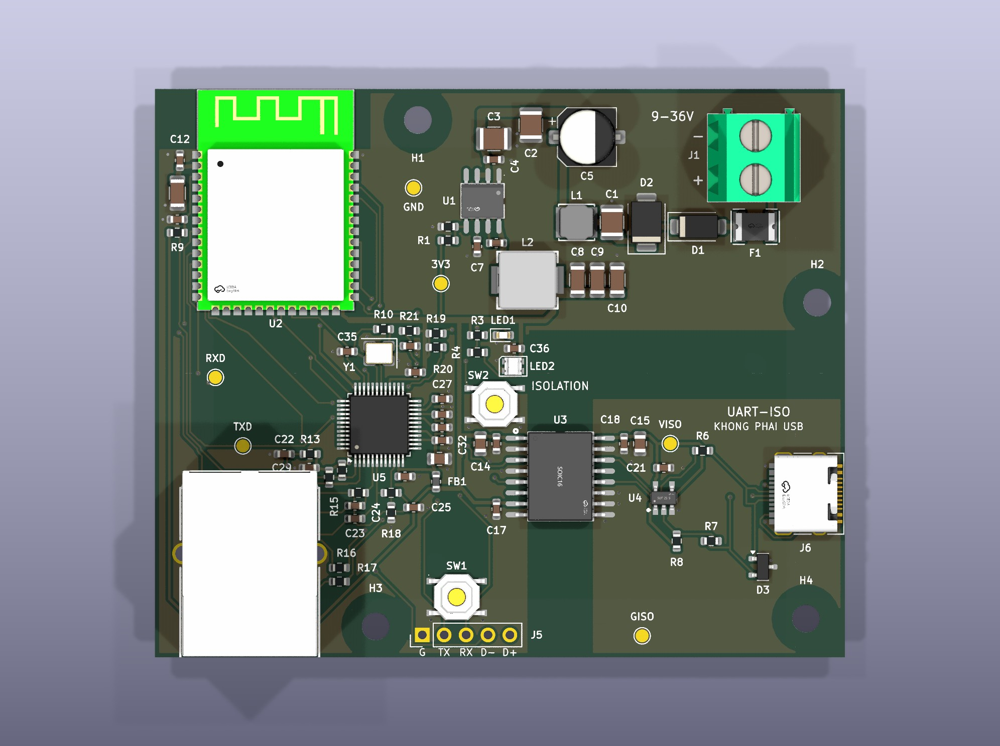

Vùng sẫm hình chữ L bên phải là khe cách ly. Sáu chấm vàng là pad đo. Hàng lỗ J5 ở mép dưới để trống, dùng khi nạp chương trình.

| Lớp trên | Lớp dưới |
|---|---|
| 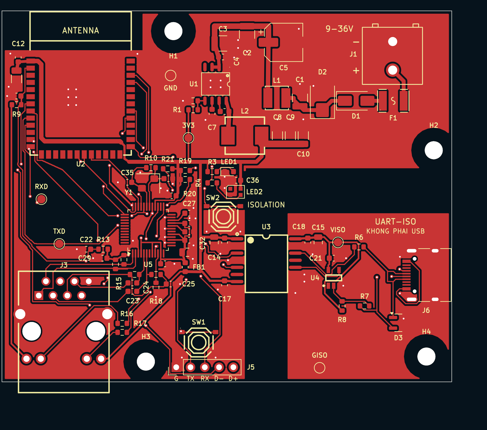 | 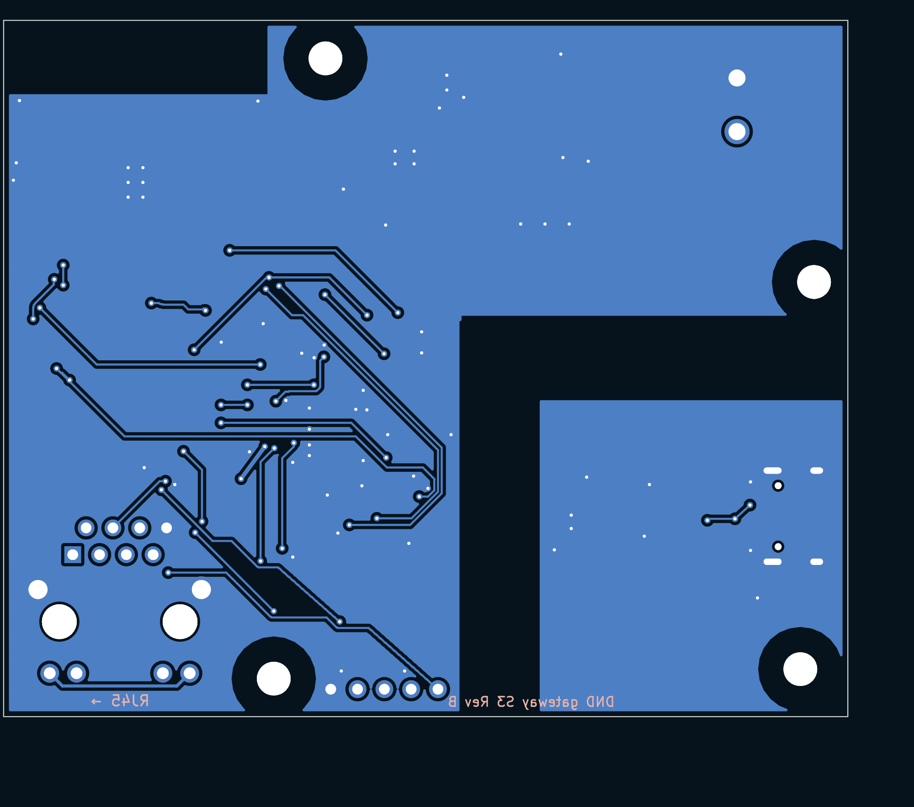 |

Cận cảnh ba vùng đáng xem kỹ. Trong các ảnh này, đỏ là lớp trên, xanh dương là lớp dưới, chữ trắng là tên đường mạch, nét đứt vàng là vùng cấm đồng.

| Nguồn | Ethernet | Vùng cách ly |
|---|---|---|
| 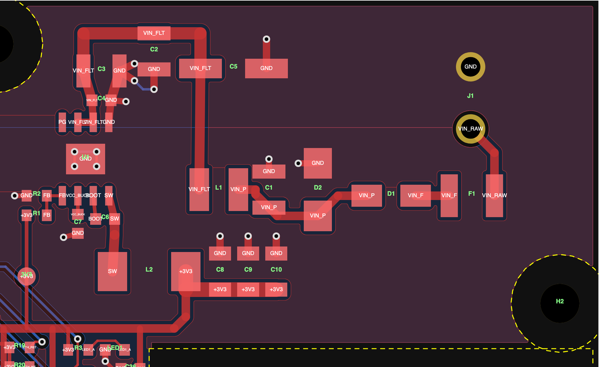 | 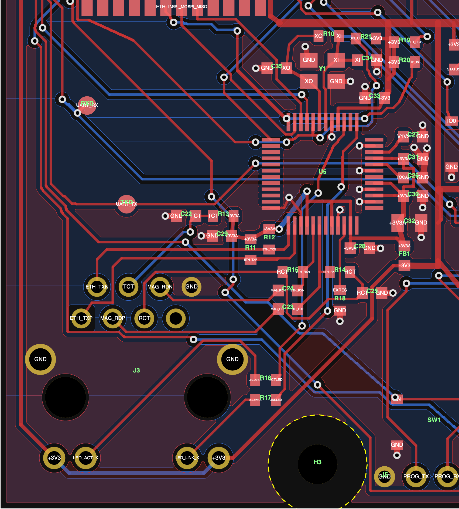 | 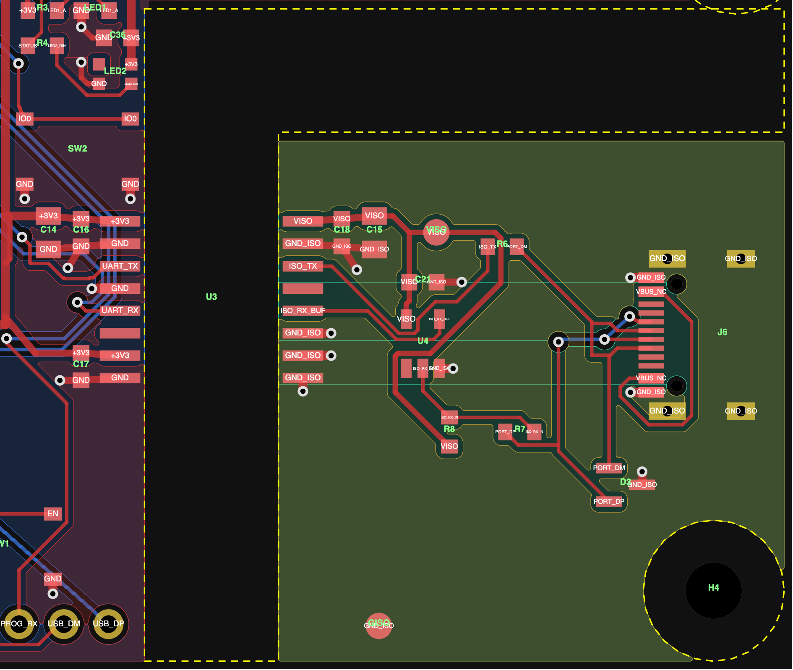 |

Ảnh 3D khác: [nhìn chéo phía sau](docs/img/3d-cheo-sau.jpg), [mặt dưới](docs/img/3d-mat-duoi.jpg). Ảnh 3D do KiCad dựng từ mô hình linh kiện, không phải ảnh chụp mạch thật.

## Thông số chế tạo

| | |
|---|---|
| Mạch | 2 lớp, 80 × 66 mm, dày 1,6 mm, đồng 1 oz |
| Đường mạch | nhỏ nhất 0,2 mm, khe hở nhỏ nhất 0,15 mm |
| Via | 0,6 mm, lỗ 0,3 mm, phủ sơn |
| Lỗ bắt vít | 4 lỗ M3 (3,2 mm), không mạ |
| Lắp ráp | 74 linh kiện, một mặt. Cổng RJ45 và cọc vít là loại cắm xuyên lỗ. Hàng chân J5 không lắp. |

File trong `fab/` được chuẩn bị cho dịch vụ lắp ráp của JLCPCB:

- `gateway-s3-revb-gerber.zip`: 9 lớp Gerber và 2 file khoan.
- `gateway-s3-revb-bom.csv`: danh sách linh kiện kèm mã LCSC, mỗi mã một dòng.
- `gateway-s3-revb-cpl.csv`: vị trí và góc đặt linh kiện.

JLCPCB đặt footprint trong thư viện của họ vào vị trí và góc ghi ở file CPL, nên chỗ nào footprint KiCad khác footprint JLCPCB thì file CPL phải bù lại. Ở mạch này có bốn chỗ: U5 xoay −90°, D3 xoay 180°, U4 xoay 270°, J6 lệch 1,41 mm. [`tools/fab/check_cpl.py`](tools/fab/check_cpl.py) kiểm tra việc này cho cả 74 linh kiện: nó đặt footprint của JLCPCB theo từng dòng CPL rồi đo xem mỗi chân rơi cách pad trên mạch bao xa và có đúng chân không.

## Hạn chế đã biết

- Mạch 2 lớp nên hai cặp Ethernet không kiểm soát được trở kháng. Bù lại, đường ngắn dưới 25 mm và không qua via.
- Lớp mass mặt dưới bị một số đường tín hiệu chậm cắt qua, có đoạn nằm dưới W5500.
- Cổng RJ45 chỉ ghi chịu 0–70 °C, cổng USB-C từ −30 đến 80 °C; chưa phải dải nhiệt công nghiệp đầy đủ.
- Vỏ cổng RJ45 nối thẳng mass, không qua tụ 1 nF / 2 kV. Chưa có linh kiện chống tĩnh điện riêng cho cặp Ethernet.
- Đầu cắm UART mượn đầu USB-C nhưng không phải cổng USB: D− là chiều phát ra thiết bị ngoài, D+ là chiều thu về, mức 3,3 V.
- LED trạng thái WS2812B-2020-V6 chạy ở 3,3 V, đúng mép dưới dải cấp 3,3–5,3 V của nó. Độ sáng trong datasheet đo ở 5 V nên trên mạch này có thể thấp hơn.

## Công cụ

Cần KiCad 9 (lệnh `kicad-cli` và module Python `pcbnew`).

```sh
# sinh lại sơ đồ từ bảng nối dây, đối chiếu với mạch in, chạy ERC, xuất PDF và SVG vào tools/schematic/out
cd tools/schematic && ./build.sh

# xuất lại Gerber, danh sách linh kiện và file vị trí vào fab/, rồi kiểm tra file vị trí
cd tools/fab && ./fab.sh && python3 check_cpl.py
```

`check_cpl.py` tải dữ liệu footprint của từng mã LCSC từ thư viện JLCEDA/EasyEDA ở lần chạy đầu và lưu vào `tools/fab/jlc-lib/`.

## Nguồn tham khảo

- Một số footprint trong `kicad/lcsc.pretty` được chuyển từ thư viện chính thức JLCEDA/EasyEDA.
- Mạch đầu cuối Ethernet theo sơ đồ mẫu của WIZnet cho W5500 dùng cổng RJ45 có sẵn biến áp.
